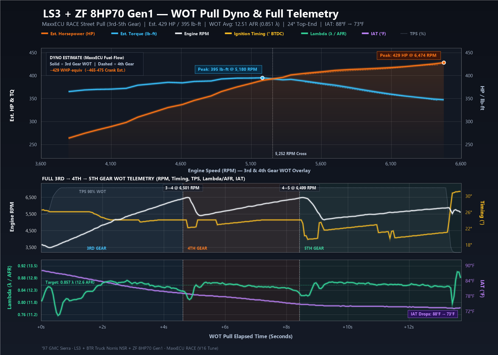
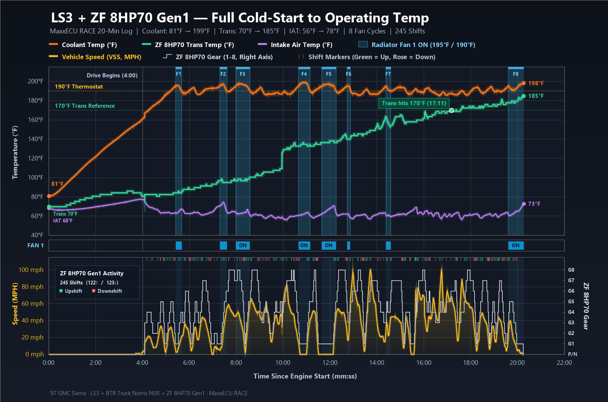

# MaxxECU MTune Universal Log & Calibration Analyzer (Antigravity Plugin)

A platform-agnostic AI street and dyno tuning co-pilot for **MaxxECU MTune** — built to work cleanly on anything from a **single-turbo 2JZ-GTE Toyota Supra** to an **LS-swapped OBS truck with a Dodge 8HP70**, a **K-series Honda**, or a **BMW turbo build**. Runs natively on Windows with **zero Python dependencies**.

## What It Does
- **Vehicle Profile Intake & Automatic MTune Cross-Check (`VEHICLE_PROFILE.md`):** Validates your physical build (Engine, Fuel System, Exhaust/Cats, Transmission, Rear Gear/Tires, and **PWM vs. Relay-Switched Fans**) directly against your `.MaxxECU-save` settings before changing a single cell.
- **Native `.MaxxECU-Zip-log` & `.MaxxECU-save` Parsing:** Automatically unpacks the embedded tune, `LogMetaData` sample rate, and 1,800+ `[ID]`-tagged RT-Data channels (including custom blended VE Load axes such as `User table 2`).
- **Closed-Loop + Open-Loop VE Calibration:** Combines measured Lambda, active closed-loop `Lambda corr`, and `LTFT` with post-FuelCut/post-AE settling guards, Flex Fuel / ethanol awareness, differential fuel-pressure checks, and dual-bank balance audits.
- **Forced Induction & NA WOT Diagnostics:** Audits boost target vs. actual MAP, WGDC saturation, IAT heat soak, knock retard, injector duty cycle, and cat-safe vs. catless cut strategies.
- **Idle, Fan Strategy (PWM vs. Relay), Cold-Start & Cruise PID:** Adapts idle/fan guidance to your exact hardware (DBW E-Throttle vs. cable IACV, PWM soft-start fans vs. high-inrush relay fans, `RadiatorFan Delay` pre-engagement behavior, `IdleCtrl User Duty Adjust` by VSS paired with `~3 mph` `Disable Spd`, `Disable TPS` pedal-brush protection, and pure-PID Cruise Control).
- **Transmission-Aware Auditing:** Adapts automatically for Manual (clutch-in coasting, shift-cut, boost-by-gear) or CAN Automatics (ZF 8HP70/8HP90 Gen1 MAPS shift lead calibration, `Automatic Upshift Offset` manual-mode protection, torque clamping, `Shiftcut Retard` vs. `ShiftCut Drop Ign/Fuel` conflict prevention, and TCC lockup).
- **Clean Project Workspace Layout (`\LOGS`, `\TUNES`, `\ARTIFACTS`):** Automatically organizes every vehicle build (locally and in optional Google Drive backups) into `\LOGS` for datalogs, `\TUNES` for `.MaxxECU-save` calibrations, and `\ARTIFACTS` for telemetry graphs, exports, and reports.
- **XML-Diff Verified `.MaxxECU-save` Generation:** Safely edits `.MaxxECU-save` files (preserving UTF-8 no-BOM + `encoding="utf-16"` header) and runs a mandatory node-by-node XML diff before you inspect in MTune via **File → Compare File**.

---

## Install in Antigravity (Windows)

### Option A — Clone Directly From GitHub (Recommended)
```powershell
git clone https://github.com/sakudog/MaxxECU-Ryker29.git "$env:USERPROFILE\.gemini\config\plugins\maxxecu-tuning"
```
To pull future updates:
```powershell
git -C "$env:USERPROFILE\.gemini\config\plugins\maxxecu-tuning" pull
```

### Option B — Download & Unzip
1. Click **Code → Download ZIP** and extract into:
   ```text
   C:\Users\<YourUsername>\.gemini\config\plugins\maxxecu-tuning\
   ```
   *(Make sure `plugin.json` sits directly inside that `maxxecu-tuning\` folder.)*
2. Open **Antigravity → Customizations / Plugins** and verify **`maxxecu-tuning`** is enabled.
3. *(Optional)* Install the **Google Sheets** plugin from the Antigravity Marketplace if you want live revision tracking.

---

## Next Steps
- Read **[QUICKSTART.md](./QUICKSTART.md)** for full tool usage, standalone PowerShell CLI commands, and the 6-step tuning workflow.
- Copy the blank template in **[VEHICLE_PROFILE.md](./VEHICLE_PROFILE.md)** (includes filled-in **2JZ-GTE Supra** and **LS-Swapped OBS Truck** examples) into your first chat.

---

## Example Telemetry Visuals Generated From Native `.MaxxECU-Zip-log` Files





> **Safety Disclaimer:** Always inspect every generated `.MaxxECU-save` revision in MTune using **File → Compare File** before flashing. Never flash someone else's tune file onto a different build.
